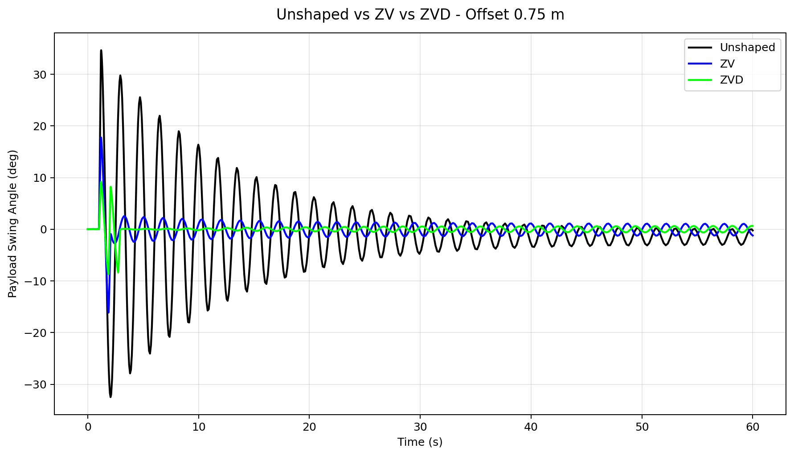

# Quadcopter Simulation Project
## Overview
This repository contains a quadcopter simulation model developed using MATLAB and Simulink.
The project is a starting point for exploring quadcopter dynamics, system modeling, and simulation-based analysis.
## Simulation Preview

The following figure shows a comparison of the quadcopter response
under different input shaping configurations.

For detailed simulation results, including individual responses,
please see the [Results folder](results/).
## Software
- MATLAB
- Simulink
## Repository Structure
- `model/` - Quadcopter simulation model
- `Pictures/` -Some Pictures of the Model 
- `results/` - Simulation results and plots
- `matlab/` - MATLAB workspace and simulation data
## Project Status
Initial simulation model uploaded. Further development and analysis will be added progressively.
---
Mechanical Engineering | Dynamics | Control
